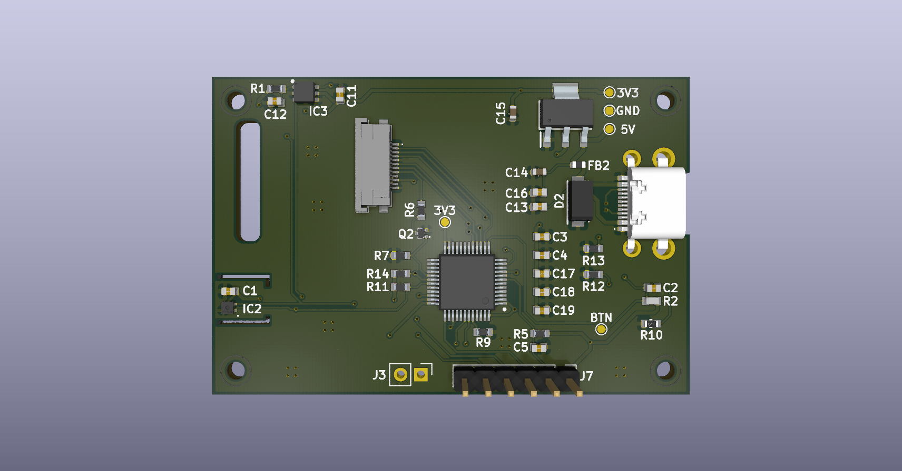
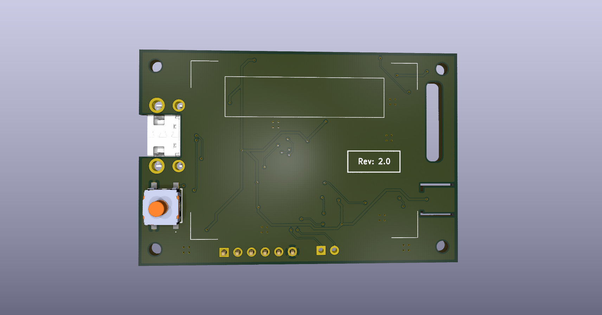

# Open AirQ Monitor


<p align="center">
  
  
</p>


## Table of Contents
- [Open AirQ Monitor](#open-airq-monitor)
  - [Table of Contents](#table-of-contents)
  - [Overview](#overview)
  - [Description](#description)
  - [Key Features](#key-features)
  - [Technical Specifications](#technical-specifications)
  - [Project Structure](#project-structure)
  - [Hardware Documentation](#hardware-documentation)
  - [Pinout \& Connectors](#pinout--connectors)
  - [Getting Started (WIP)](#getting-started-wip)
    - [Opening the KiCad project](#opening-the-kicad-project)
    - [Generating fabrication files](#generating-fabrication-files)
    - [Flashing the firmware](#flashing-the-firmware)
  - [Ordering \& Fabrication Guidelines](#ordering--fabrication-guidelines)
  - [Test Firmware](#test-firmware)
  - [Known Issues \& Future Improvements](#known-issues--future-improvements)
  - [Safety Notes](#safety-notes)
  - [Revision History](#revision-history)
  - [License](#license)
  - [Acknowledgments](#acknowledgments)
  - [Contact](#contact)


## Overview
- **Description:** STM32 based custom-board to monitor temperature, humidity and VOC
- **Status:** Stable - Revision 2.0
- **License:** Apache-2.0 license


## Description
Open AirQ Monitor is a very simple STM32 custom PCB with a temperature/humidity sensor and a
VOC sensor. It's goal is to be a consumer / gadget product which you can keep in your bedroom,
rather than a professional industrial solution to monitor ambient parameters.
Given that, I decided to use an LCD TFT RGB display so the firmware application can be more
"fancy" and "nice". <br>
As an hobbistic project, I wanted it to be as cheap and easy to design as possible. <br>
This can be seen as a starting point to build a more advanced product with more functionality,
so feel free to fork the repo and customize it as you like!


## Key Features
- LCD TFT [128x160 px] Display
- Dimmable display backlight
- USB-C powered (5V)
- Push-button as a general input or EXTI
- Real-time temperature and humidity measurement
- Real-time VOC measurement


## Technical Specifications
| Parameter | Value |
| :--- | :--- |
| **Input Voltage** | 5V |
| **Typical Current Draw** | **TODO** (e.g. ~xx mA idle / xx mA peak) |
| **Microcontroller / Core** | STM32L431CCT6TR |
| **Microcontroller / RAM** | 64 KB |
| **Microcontroller / FLASH** | 256 KB |
| **VOC Sensor** | SGP40-D-R4 |
| **Temp/Humidity Sensor** | SHT40-AD1B-R2 |
| **TFT Display** | ER-TFT018-3 |
| **Dimensions** | 60x40 mm |
| **Mounting Holes** | M2 |


## Project Structure
```text
├── docs/             # Documentation, schematics PDF, and renders
├── fabrication/      # Production files (Gerbers, BOM, Pick & Place)
├── design/           # KiCad project source files
├── exported          # .step, BOM, ...
├── LICENSE           # License file
└── README.md         # Project documentation
```

## Hardware Documentation
Check the docs/ folder.


## Pinout & Connectors
For the complete pinout check the schematic.
| Pin | Function | Description | Direction
| :--- | :--- | :--- | :--- |
| PA1 | SPI_CLK | SPI Clock Signal | Out |
| PA3 | BUTTON_IN | External Button Signal | In |
| PA4 | DC_DISPLAY | Data / Command Display Signal | Out |
| PA5 | RST_DISPLAY | Display Reset Signal | Out |
| PA6 | CS_DISPLAY | Display Chip Select Signal | Out |
| PA7 | SPI_MOSI | Display Serial Data Signal | Out |
| PA8 | BCK_LIGHT_DISPLAY | Display Backlight Signal | Out |
| PA9 | I2C_SCL | SCL Line of I2C bus | Out |
| PA10 | I2C_SDA | SDA Line of I2C bus | In / Out |
| PA11 | SWDIO | Serial Wire Data Signal | In / Out |
| PA14 | SWCLK | Serial Wire Protocol Clock Signal | In |
| PB3 | SWO | Serial Wire Protocol Output Signal | Out |


## Getting Started (WIP)
 
### Opening the KiCad project
1. Install [KiCad 10.0](https://www.kicad.org/download/) or later.
2. Clone this repository.
3. ...

### Generating fabrication files
1. Open the PCB editor in KiCad.
2. Export Gerbers, drill files, and Pick & Place using KiCad's built-in plotter (or the AISLER plugin, see [Ordering & Fabrication Guidelines](#ordering--fabrication-guidelines)).
3. Upload the generated files in your chosen manufacturer website (es. AISLER)
4. Check the correctness of the layout in the preview before ordering!

### Flashing the firmware
1. Connect an SWD programmer (e.g. ST-Link V2/V3) to the `SWDIO`/`SWCLK`/`SWO` pins.
2. Build and flash the firmware from the [Test Firmware](#test-firmware) repository following its own instructions.
3. Power the board via USB-C (5V) once flashing is complete.


## Ordering & Fabrication Guidelines
The chosen manufacturer is AISLER and every constraints in the layout that I used is based on their specifications.<br>
I used the AISLER plugin for KiCad to export all fabrication files. Just for reference, I created them manually in
fabrication directory. <br>
However, I didn't double checked those and a further analysis is suggested.
Also, the PCB was manually assembled by me and no assembly services were used from the manufacturer.


## Test Firmware
Test firmware written in C is provided [here](https://github.com/Summanuss/openairqmonitor_testfw.git) <br>
More information about it are provided in the linked repository.


## Known Issues & Future Improvements
- The SHT40 sensor is not perfectly thermally decoupled from the PCB and its reading can be a bit altered from the heat generated from the display and the rest of the PCB.
- The flashing and debugging pins are permanently soldered on the PCB which is not optimal.
<br>Ideas for revision 3.0:
- Correct the known issues.
- Provide the support for a battery powered device.


## Safety Notes
- The board is powered via USB-C at 5V - use a standard certified USB-C cable/power source.
- Use the SWD connector interface **ONLY** for flashing and debug.


## Revision History
- **v2.0:** Final and stable version
- **v1.0:** First working prototype


## License
Distributed under the Apache-2.0 License. See `LICENSE` for more information.


## Acknowledgments
I would like to thanks my friends which worked on the final firmware product and device enclouse:
- D.G.
- A.B.


## Contact
Mail: serafin.jacopo99@gmail.com